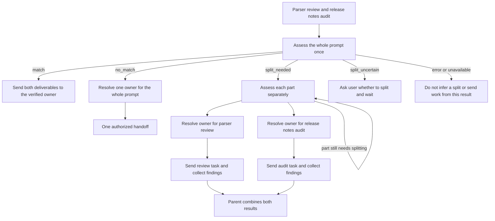

# How a request moves through pi-subagentura

Choose a **parent mode** to set the delegation policy. In Orchestrator v2, two separate settings change that policy: `--split` controls decomposition; classifier advice helps decide where work belongs. None of these settings selects a terminal backend, changes the parent model, or grants a child permission to edit files.

## Trace a prompt to its task

Example prompt: **“Review the parser for compatibility and independently audit the release notes.”** Read from left to right. Each numbered row is one launch configuration, not a step after the previous row. The v2 paths assume a clear request, native routing, no named target, and a safe classifier description.

```text
Prompt
├─ 1  Ordinary                 → parent works or delegates → answer
├─ 2  Workflow orchestrator    → choose procedure → run workers by phase → collect results → answer
└─ Orchestrator v2             → list live children and check their responsibilities
   ├─ Without --split
   │  ├─ 3  Advisor off        → parent selects owner → handoff → result
   │  ├─ 4  Advisor optional   → clear owner? use it; unclear choice? ask advisor → resolve owner → handoff → result
   │  └─ 5  Advisor forced     → assess implicit owner choice → resolve owner → handoff → result
   └─ With --split
      ├─ 6  Advisor off        → parent identifies independent tasks → resolve owner per task → handoffs → combine results
      ├─ 7  Advisor optional   → advisor registered? assess whole prompt; otherwise use path 6
      └─ 8  Advisor forced     → assess whole prompt; if required advice is unavailable, stop and report why
```

| Path | Launch command                                           |
| ---- | -------------------------------------------------------- |
| 1    | `pi`                                                     |
| 2    | `pi --orchestrator`                                      |
| 3    | `pi --orchestratorv2`                                    |
| 4    | `PI_ORCHESTRATOR_ROUTER=jev pi --orchestratorv2`         |
| 5    | `pi --orchestratorv2 --force-jev`                        |
| 6    | `pi --orchestratorv2 --split`                            |
| 7    | `PI_ORCHESTRATOR_ROUTER=jev pi --orchestratorv2 --split` |
| 8    | `pi --orchestratorv2 --split --force-jev`                |

For advisor-off paths, leave `PI_ORCHESTRATOR_ROUTER` unset. Setting it to `jev` **and** using `--force-jev` selects forced mode, not a ninth path. On path 5, a complete registry with no eligible children needs no classifier call. On paths 7 and 8, the whole-prompt assessment still runs with no children: **one task or several?** is a separate question from **who owns it?**

### Follow the whole-prompt result (paths 7 and 8)



**Explicit target takes a different path.** “Send the parser review to child A” → verify A and its authority → send the authorized task to A. Do not run implicit owner selection, even in forced mode. On versions with the [selected-child scope check](#4-use-an-explicit-target-does-advice-override-the-user), the parent may ask about A before sending: `fit` → proceed if authorized; `mismatch` → do not assign out-of-scope work; `uncertain` → clarify. None of these results sends the task.

## 1. Receive a request: who does the work?

| Start Pi with                 | One clear task                                                                                                                        | Several deliverables                                                                                                                |
| ----------------------------- | ------------------------------------------------------------------------------------------------------------------------------------- | ----------------------------------------------------------------------------------------------------------------------------------- |
| `pi`                          | The parent can do the work or use a sub-agent. A general request does not start a workflow automatically.                             | The parent can delegate or run a workflow when requested. No automatic split policy applies.                                        |
| `pi --orchestrator`           | The parent uses workflow-oriented guidance. Use a workflow for a repeatable procedure; this mode does not use the v2 routing advisor. | A workflow script can assign phases to workers and collect their results. The script controls the sequence.                         |
| `pi --orchestratorv2`         | The parent routes clear work to a specialist. It checks for an existing owner before creating one.                                    | Decomposition is optional. Do not assume that several steps require several owners.                                                 |
| `pi --orchestratorv2 --split` | Keep one coherent handoff together.                                                                                                   | Route independent parts separately, respect dependencies, and return one combined answer. `--split` does not split a terminal pane. |

Do not combine `--orchestrator` and `--orchestratorv2`. Use `--split` only with v2. In any mode, clarify an unresolved requirement or permission rather than guessing. A request to inspect a problem is not permission to implement a fix.

## 2. Select an owner: when does the classifier run?

This table applies to a **parent v2 session** with a clear request and no explicit target. First list current owners. For native children, use the parent's authority records and live runtime state. A name, alias, or project cache is not proof of ownership.

| Classifier mode                         | Without `--split`                                                                                                                                                                              | With `--split`                                                                                                                                                                                               |
| --------------------------------------- | ---------------------------------------------------------------------------------------------------------------------------------------------------------------------------------------------- | ------------------------------------------------------------------------------------------------------------------------------------------------------------------------------------------------------------ |
| Off (default)                           | Use confirmed responsibility, access, and liveness to select the owner. No classifier call.                                                                                                    | The parent identifies independent parts and applies the same ownership rules to each.                                                                                                                        |
| Optional (`PI_ORCHESTRATOR_ROUTER=jev`) | Use the advisor when the choice among plausible owners is unclear. If it is unavailable, use the base ownership rules.                                                                         | With an available advisor, assess the whole request first. If no advisor is registered, use the base split policy. A failed assessment is not permission to split.                                           |
| Forced (`--force-jev`)                  | Assess an implicit native owner choice even with one eligible child. A complete, empty eligible registry needs no owner classification. If required advice is unavailable, report the blocker. | Assess the whole request even with zero eligible children: the question still includes whether to split. Assess individual parts only after `split_needed`. Do not substitute another classifier on failure. |

For example, use `pi --orchestratorv2 --split --force-jev` for required whole-request assessment. Forced mode does not need the environment switch. Both advisor modes need a configured, supported classifier. Send only a minimal safe description of the action, scope, deliverable, and access. Do not send transcripts, secrets, code excerpts, or the worker's full message. See [classifier setup and the no-call path](docs/jev-routing.md).

## 3. Act on advice: what happens next?

| Result                              | Parent action                                                                                                                                                                                                 |
| ----------------------------------- | ------------------------------------------------------------------------------------------------------------------------------------------------------------------------------------------------------------- |
| `match`                             | Check current authority and send the assessed work to that child. Advice does not send or reserve anything.                                                                                                   |
| `no_match`                          | No owner was selected. Reuse an exact authorized owner if current records establish one. Ask if multiple plausible owners remain. Create one specialist only when complete discovery shows no suitable owner. |
| `split_needed`                      | Split the whole request into independent authorized parts. Assess each part with `part: true` and its own description. Repeat for any part that still needs a split. Only assign tasks ready for one owner.   |
| `split_uncertain`                   | Ask the user whether to split. Wait before sending work or creating a child.                                                                                                                                  |
| `state_changed`                     | Refresh the relevant ownership and runtime evidence before deciding. Do not act on stale advice.                                                                                                              |
| Unavailable, error, or cancellation | No valid recommendation. Apply the mode's failure rule above; stop on cancellation.                                                                                                                           |

**Example:** “Review the parser and write a report” can be one handoff: the report is the review's output. “Review the parser for compatibility and independently audit the release notes” can be two. With split assessment, only `split_needed` starts per-part classification. The [prompt comparison in PR #279](https://github.com/lmn451/pi-subagentura/pull/279) is an evaluation, not a runtime mode.

## 4. Use an explicit target: does advice override the user?

No. Naming a child, requesting a new child, attaching to a pane, and focusing a pane are not implicit owner choices. Even in forced mode, do not use owner selection to substitute a different child. Verify the requested target and the caller's authority. On a host-managed route, use that host's live discovery and controls, not the native classifier.

**Version note:** [PR #280](https://github.com/lmn451/pi-subagentura/pull/280) adds a separate **selected-child scope check**. Use this only on a version that includes `scopeCheckChildId`. With optional or forced advice enabled, the parent can explicitly call `resolve_orchestrator_route` with that ID and a safe `routingDescription`. Sending a message does not trigger the check.

For a read-only parser reviewer:

- `fit`: “Review the parser and report errors.” The scope fits. Sending is a separate action.
- `mismatch`: “Edit the parser.” The task exceeds the role. Do not treat the answer as permission to edit or as a replacement-owner recommendation.
- `uncertain`: “Handle the parser issue.” The evidence does not establish fit. Clarify the action or responsibility. An unavailable classifier is not an `uncertain` judgment.

## 5. Execute, collect results, and continue

| Execution path    | Start and follow up                                                                                                                                                                                                            |
| ----------------- | ------------------------------------------------------------------------------------------------------------------------------------------------------------------------------------------------------------------------------ |
| In-process job    | Use `subagent_with_context` when the worker needs parent context, or `subagent_isolated` for a separate context. For an async job, check status, get its result, or cancel it by job ID. No terminal pane is required.         |
| Interactive child | Launch or reuse a verified child. Send authorized follow-up work to the same child. Inspect status and artifacts, attach, or cancel as needed. If the target cannot be verified, do not silently switch backends.              |
| Workflow          | Run a trusted workflow script. Follow workflow progress and read its aggregate result. Workflow-owned child completions do not also notify the parent as standalone jobs. An in-process child cannot invoke the workflow tool. |

These are execution paths, not extra parent modes. Ordinary and workflow-oriented parents can use interactive children. V2 normally uses attachable specialists; workflow and in-process tools remain available for compatibility. Host hints can supply guidance in any parent mode, but do not prove that a pane belongs to this session.

For background work, the default completion path shows a human-readable event and gives the parent a manifest with references, not the child's full output. Read the referenced result before reporting it. With independent delivery (`each`), ready results can arrive together when the parent is idle. Use `group` with an explicit shared group ID when results must be coordinated. A completion notice is not permission for a new assignment.

See the [tool and completion reference](README.md#tools), [workflow guide](docs/workflows.md), and [ownership rules](docs/ownership.md).
